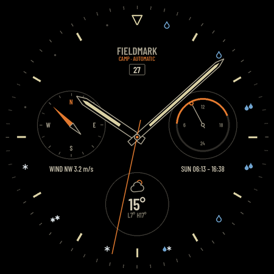

# FIELDMARK Watch Face

Wear OS 用の、キャンプと釣りのためのウォッチフェイスです。機械式のフィールドウォッチ風の見た目で、有機ELの電池消費を抑えるように描いています。

Watch Face Format (WFF v2、Wear OS 5 以降) で作っています。



## 構成

- `watchface/` … ウォッチフェイス本体。`watchface/src/main/res/raw/watchface.xml` と画像は `tools/generate_fieldmark.py` が生成します(XML を直接編集しないでください)
- `wear/` … 時計の連携アプリ「FIELDMARK」。風・日の出と日の入り・潮位を [Open-Meteo](https://open-meteo.com/) から取り、コンプリケーションとして文字盤に渡します。スマホアプリはいりません
- `tools/generate_fieldmark.py` … 文字盤の XML と画像を生成するスクリプト。寸法・色・天気マークの割り当てはここで変更します

```sh
pip install pillow
python3 tools/generate_fieldmark.py
./gradlew assembleDebug
```

## ダウンロードと入れ方

1. GitHub の **Actions** タブで、main の最新の「Build」を開きます
2. 下の **Artifacts** から次の2つをダウンロードして展開します
   - `fieldmark-wear-debug` … 連携アプリ
   - `fieldmark-watchface-debug` … 文字盤
3. 時計に入れます(ワイヤレスデバッグで接続した状態で)
   ```sh
   adb install -r wear-debug.apk
   adb install -r watchface-debug.apk
   ```
4. 時計で「FIELDMARK」アプリを開き、位置の利用を許可します。「常に位置を使う」も許可すると、移動しても場所が自動で変わります
5. 文字盤を FIELDMARK に変えます

入れる順番は連携アプリ、文字盤の順です。文字盤を先に入れていた場合は、連携アプリを入れた後に文字盤を選び直してください。

## できること

文字盤の編集画面で選べるもの:

- **モード**: キャンプ(初期値)・釣り
- **秒針**: 1秒ごと(初期値)・なし(電池を節約)

両方のモード:

- 時刻(時針・分針・1秒ごとに動く秒針)、日付
- **12時間分の天気マーク**: 時の目盛りの間に、時針がある時間帯を「今」として、時計回りに1時間ずつ先の天気を出します。マークは6種類です
  | 天気 | マーク |
  |---|---|
  | 降らない | 暗い小さな点 |
  | 弱い雨(小雨・雨) | 輪郭のしずく1つ |
  | 強い雨(大雨・雷雨) | 塗りつぶしたしずく2つ |
  | 弱い雪(小雪・雪) | 細い結晶1つ |
  | 強い雪(大雪) | 太い結晶2つ |
  | みぞれ | しずくと結晶 |

  予報は Wear OS の天気データ(`WEATHER.HOURS`)を使います。時計が持っていない時間帯は何も出ません
- **常時表示**: 黒地に輪郭だけの時針・分針と点のインデックス、日付、天気マーク(雨と雪だけ)。秒針はありません

キャンプモード:

- 9時側: 風向(風が吹いてくる方角を指す)と風速
- 3時側: 24時間のサンダイヤル。日の出から日の入りまでを弧で、今の時刻を太陽の針で示します
- 6時側: 今の天気、気温、最低・最高気温、降水確率
- 常時表示: 日の入り時刻と風

釣りモード:

- 9時側: 月齢(月の形と縁の三角)と潮名(大潮・中潮・小潮・長潮・若潮)。どちらも Wear OS の月齢データから出します
- 3時側: 風向と風速
- 6時側: 今日のタイドグラフ(0〜24時、下の細い線が昼の時間)と次の満潮・干潮
- 常時表示: 月の形、潮名、次の満潮

## データと電池

- 天気・1時間ごとの予報・月齢は Wear OS 自体のデータで、文字盤は通信しません
- 連携アプリは1時間に1回、位置(おおまかな位置、1時間以内の測位があればそれを使う)と Open-Meteo の天気 API を1回読みます。潮位は6時間に1回か、5km 以上動いたときだけ読みます
- 海から遠い場所では潮位がないので、タイドグラフと満潮・干潮は空になります
- Open-Meteo の潮位はモデルの計算値で、湾の奥などでは実際とずれることがあります
- Open-Meteo の無料 API は非商用向けです。Google Play で有料公開するなどの場合は利用条件を確認してください

## 変更履歴

仕様や見た目が変わる変更は `CHANGELOG.md` に書きます。

## 開発メモ

- 連携アプリのデータ用の枠(風・日の出入り・タイドグラフ・満潮干潮の4つ)は、文字盤の編集画面に出ない固定の枠です。公開後は枠の追加・削除・並べ替えをしないでください。時計は文字盤を追加した時点の並び順で各枠のデータ元を覚えます
- 天気マークの割り当て(Wear OS の天気コード 0〜15 → マーク)は `FORECAST_MARKS` にあります。「雨」「雪」は弱い側に入れています
- CI は生成スクリプトの出力と `watchface.xml` が一致するか、WFF のバリデータ、ビルドと単体テストを確認します
